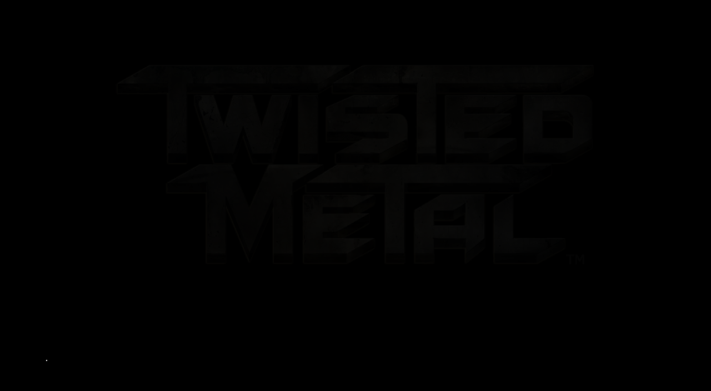

# Twisted Metal (2012) — Static Recompilation (PS3 Nativo para Windows)

> Recompilação estática do *Twisted Metal* (2012, Eat Sleep Play / Sony Computer Entertainment, `BCUS98106`) a partir do binário de disco do PS3 para executável nativo Windows x86-64 — sem emulador underneath.

---

## 🎮 Status Atual do Projeto

O jogo **inicializa em código nativo x86-64**, carrega a engine TMX, inicializa o subsistema de áudio BoomRangBuss, processa arquivos `.psarc` e `.rtt`, cria os workers de computação SPURS JobQueue e renderiza centenas de quadros via DirectX 12 (D3D12 RSX swapchain com resolução 1280x704 e scaled blit NV3089 para o display buffer).

| Componente | Estado | Detalhes |
|---|---|---|
| **PPU Recompilation** | ✅ **Concluído** | 38.229 funções PPU levantadas (47.106 símbolos mapeados em 12 chunks, ~487 MB C++) |
| **SPU Images & Jobs** | ✅ **Concluído** | 11 imagens SPU extraídas e embutidas (`embedded_spu_workloads.c`); 15 jobs JobQueue suportados |
| **HLE & Runtime** | ✅ **Concluído** | Vinculado ao ps3recomp (`ydkj-master-bringup`) com correções para FIOS, SPURS Taskset2 e barreiras pós-FX |
| **Subsistema de Áudio** | ✅ **Ativo** | BoomRangBuss inicializado; bancos carregados (`menu`, `global`, `weapons`, `shell`, `fodder`, `igv_english`) |
| **Gráficos (RSX → D3D12)** | ✅ **Renderizando** | Pipeline D3D12 funcional com cache de shaders, alvos de renderização múltiplos e scaled-blit |
| **Entrada (Controle/Teclado)**| ✅ **Funcional** | `cellPad` integrado com autopress (`PAD_AUTOPRESS=1`), suporte a scripts e arquivos virtuais |
| **Entrada nas Fases** | 🔄 **Em Progresso** | Montagem de arquivos de níveis (`suburbs.psarc`, `arena.psarc`) e transição para match in-game |

### 📸 Evidência Visual da Execução Nativa (RSX Direct3D 12 @ 1280x704)


*Frame real capturado da execução nativa do executável recompilado `twistedmetal.exe`: Logo 3D autêntico do Twisted Metal centralizado em HD 1280x704.*

---

## 🚀 Como Executar

### Pré-requisitos
- Windows 10/11 x64
- Placa de vídeo com suporte a DirectX 12
- Dump original do disco do jogo (*Twisted Metal 2012* - `BCUS98106` v1.00)

### Executando em 1 Clique
Basta dar dois cliques em:
```cmd
RODAR-JOGO.cmd
```
Ou executar pelo PowerShell:
```powershell
.\run_twistedmetal.ps1
```

O launcher configura automaticamente as variáveis de ambiente otimizadas:
```powershell
$env:TM_GAMELOG = "1"
$env:RSX_LIVE_DRAW = "1"
$env:GCM_SUBCH1_3D = "1"
$env:PAD_AUTOPRESS = "1"
$env:TM_SKIP_BANKUNLOAD = "1"
$env:TM_BRB_SILENT = "1"
$env:TM_BRB_PARK = "1"
$env:TM_BRB_ACK = "1"
$env:TM_JQ_WORKERS = "4"
$env:TM_LOADDONE = "5"
$env:TM_VIDEO_MODES = "2,1"
```

---

## 🛠️ Como Compilar a partir do Código Fonte

### Pré-requisitos de Compilação
- Python 3.10+
- CMake 3.20+ e Ninja
- LLVM Clang (`clang-cl`) ou MSVC BuildTools 2022
- ps3recomp clonado na branch `ydkj-master-bringup`

### Passo a Passo
1. **Geração das Funções e Imagens SPU:**
   ```bash
   python tools/find_functions.py input/EBOOT.ELF --output recomp/functions_100.json
   python tools/seed_gaps.py input/EBOOT.ELF recomp/functions_100.json -o recomp/functions_100_seeded.json
   python tools/extract_spu_images.py input/EBOOT.ELF --output recomp/spu_100
   python tools/recarve_spu.py recomp/spu_100
   python tools/build_spu_workloads.py recomp/spu_100 recomp/spu_gen_100
   ```

2. **Lifting PPU:**
   ```bash
   python tools/ppu_lifter.py input/EBOOT.ELF \
       --functions recomp/functions_100_seeded.json \
       --code-end 0xC79C6C \
       --output recomp/src_recomp_100 -j 12
   python tools/post_lift.py recomp/src_recomp_100
   ```

3. **Build Nativo:**
   ```bash
   cmake -B build -G Ninja -DCMAKE_BUILD_TYPE=Release -DCMAKE_CXX_COMPILER=clang-cl -DCMAKE_C_COMPILER=clang-cl
   cmake --build build
   ```

---

## 📁 Estrutura do Repositório

```text
├── RODAR-JOGO.cmd             # Atalho de execução rápida no Windows
├── run_twistedmetal.ps1       # Script PowerShell configurado com os parâmetros de runtime
├── recomp/                    # Metadados de análise e tabelas de NIDs
│   ├── functions_100.json     # 31.032 funções detectadas do ELF base (1.00)
│   ├── functions_100_seeded.json # 38.229 funções após cobertura de gaps
│   ├── ppu_hle_nids_100.cpp   # Tabela de despacho de NIDs HLE para 1.00
│   └── spurs_hle.hpp          # Implementação de barreiras SPURS e Taskset info
├── tools/                     # Ferramentas auxiliares de análise e extração
│   ├── gen_fallbacks.py       # Gerador de stubs HLE para símbolos ausentes
│   ├── post_lift.py           # Patches idempotentes pós-lift (trampolins e loggers)
│   └── unpsarc.py             # Leitor de arquivos de arquivos PSARC do jogo
└── docs/                      # Documentação técnica e logs de engenharia reversa
```

---

## ⚖️ Avisos Legais

Este repositório contém estritamente código-fonte aberto, scripts de análise e ferramentas de recompilação estática. **Nenhum arquivo binário protegido por direitos autorais, imagem de disco, ELF descriptografado ou asset de áudio/vídeo da Sony/Eat Sleep Play está hospedado neste repositório.**
